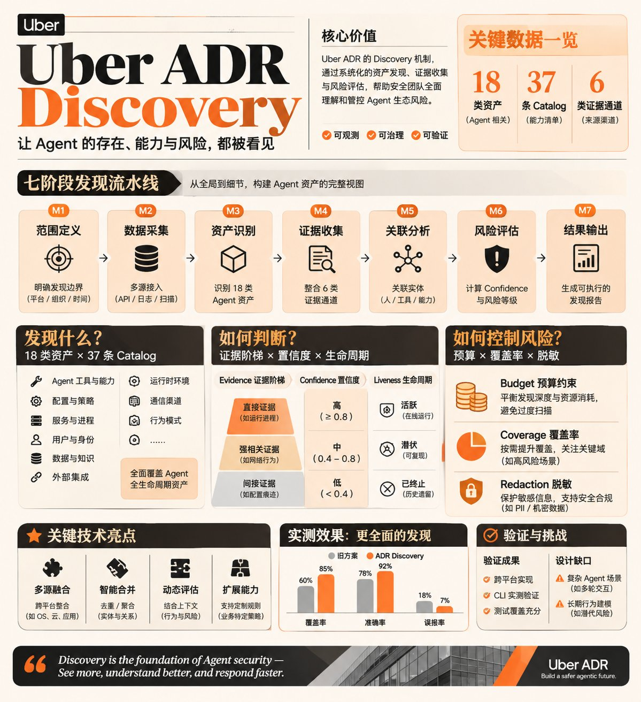

# Agentic ADR 笔记

Uber ADR（Agentic AI Detection and Response）的源码级研究笔记。非官方文档，数字来自代码阅读与本机实测，不转述 README。

概览图。阶段命名与置信分档以 [discovery/source-notes.md](discovery/source-notes.md) 为准。

## 内容

| 组件 | 笔记 | 覆盖范围 |
|---|---|---|
| Discovery | [discovery/source-notes.md](discovery/source-notes.md) | 18 类 Kind、37 条 catalog、M1–M7 七个阶段、判定层、Coverage、脱敏、三平台实现、实测、测试覆盖 |
| Sensor | [sensor/source-notes.md](sensor/source-notes.md) | 11 个代理平台、AgentEvent 统一 schema、BaseParser 架构、AgentObserver 编排、OTLP 导出、诊断健康、正反例测试方法集 |
| ADR-Bench | [bench/source-notes.md](bench/source-notes.md) | 304 任务、134 服务器、17 类威胁、执行器与打包格式、真值与指标、AgentDojo 集成、正反例测试方法集 |

## 版本锚定

| 项 | 值 |
|---|---|
| 源码 | `uber/ADR` 的 `Discovery/`、`Sensor/` 和 `Detection/` 目录 |
| commit | `6b33dff`（2026-10-16），Bench 与 Detection 共用 |
| catalog | `2026.10.12` |
| schema | `1.2`（Discovery）；AgentEvent schema（Sensor） |
| tasks | 304 条（261 benign / 43 malicious），`Detection/tasks.json` |
| Python | 3.11+（Discovery）；3.9–3.13（Sensor）；3.10–3.12（Bench） |

## 说明

代码坐标在正文写成 `文件::符号`，在附录写成 `文件:行号`。例如 `judge/findings.py::findings_for` 与 `judge/findings.py:32`。

实测数据来自 macOS 单机，路径中的用户名替换为 `<user>`，主机名替换为 `<host>`。所有输出片段取自同一次运行，未拼接。

笔记里出现的数字都能对回代码常量或实测输出。与官方 README 口径不一致的地方，以代码为准并标注差异。

## 范围

Discovery、Sensor、ADR-Bench 已完成。Detection 的检测器部分尚未开始。

Bench 的实测数据来自 macOS 单机，依赖仓库自带的打包产物（`adr_bench_20251017_151604.jsonl`），未执行需要 API key 的端到端运行；涉及执行层的结论以代码路径和单元测试为依据，已在 `bench/source-notes.md` 附录 C 标注。

引用请注明出处。

改动规则见 [CONTRIBUTING.md](CONTRIBUTING.md)。`main` 只读，一律走分支 + PR。
