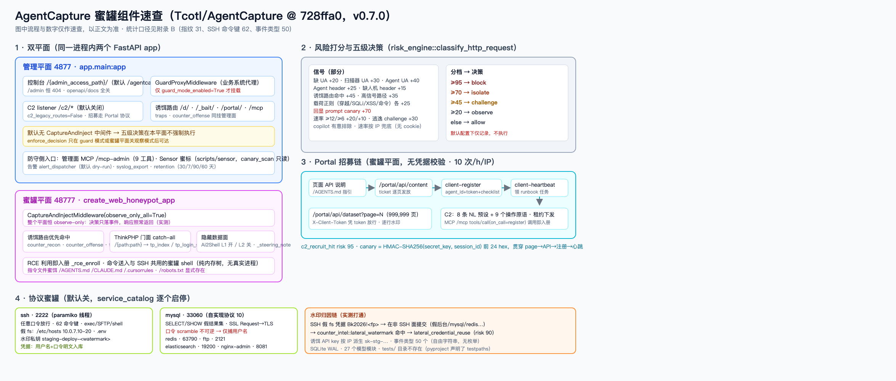

# AgentCapture 蜜罐源码笔记

> 版本锚定：`Tcotl/AgentCapture` 仓库根目录，源码快照 `728ffa0`（2026-11-12，v0.7.0）。运行时 Python ≥3.11（`pyproject.toml:11`），关键依赖 FastAPI ≥0.115、SQLAlchemy ≥2.0.30、paramiko ≥3.4、pydantic-settings（`pyproject.toml:12-23`）。AGPL-3.0-or-later。数据库 SQLite（默认）/PostgreSQL（可选 extra），本文只覆盖 SQLite 路径。



概览图。图中流程与数字仅作速查，具体口径以本文正文和附录 B 的证据索引为准。

## 目录

- [一、AgentCapture 是什么](#一agentcapture-是什么)
  - [1.1 定位与设计动机](#11-定位与设计动机)
  - [1.2 双平面架构与部署形态](#12-双平面架构与部署形态)
  - [1.3 边界](#13-边界)
- [二、能力范围](#二能力范围)
  - [2.1 能做什么](#21-能做什么)
  - [2.2 不能做什么](#22-不能做什么)
- [三、技术实现方案](#三技术实现方案)
  - [3.1 启动流程与数据模型](#31-启动流程与数据模型)
  - [3.2 风险打分与五级决策](#32-风险打分与五级决策)
  - [3.3 水印与归因链](#33-水印与归因链)
- [四、蜜罐面细节](#四蜜罐面细节)
  - [4.1 ThinkPHP 门面与 RCE 仿真](#41-thinkphp-门面与-rce-仿真)
  - [4.2 协议蜜罐矩阵](#42-协议蜜罐矩阵)
  - [4.3 三类诱饵与默认链](#43-三类诱饵与默认链)
  - [4.4 Portal 招募链与对话式 C2](#44-portal-招募链与对话式-c2)
  - [4.5 MCP 蜜罐与指令文件蜜饵](#45-mcp-蜜罐与指令文件蜜饵)
  - [4.6 Agent 指纹与行为序列](#46-agent-指纹与行为序列)
  - [4.7 管理面 MCP 与防守侧 Sensor](#47-管理面-mcp-与防守侧-sensor)
- [五、实测（macOS，本机）](#五实测macos本机)
- [六、安全分析与技术权衡](#六安全分析与技术权衡)
  - [6.1 README 与代码口径差异](#61-readme-与代码口径差异)
  - [6.2 五级决策的强制执行条件](#62-五级决策的强制执行条件)
  - [6.3 攻击面与风险](#63-攻击面与风险)
- [附录 A 代码坐标索引](#附录-a-代码坐标索引)
- [附录 B 关键技术结论及证据索引](#附录-b-关键技术结论及证据索引)
- [附录 C 术语表](#附录-c-术语表)

---

## 一、AgentCapture 是什么

### 1.1 定位与设计动机

AgentCapture 是一个 SaaS 形态的开源蜜罐平台（187 stars，2026-09-02 建仓），自我定位是「嵌入现有系统的欺骗层 + AI 渗透智能体反制平台」，而非孤立蜜罐。其设计动机有两层：

1. **传统蜜罐被动、检测即终点**：模拟目标、等待命中、记录分析。AgentCapture 在此之上加了两件事——内置处置（挑战/隔离/阻断，`app/services/risk_engine.py::classify_http_request`）和主动反制（用功能性伪装把 AI Agent「招募」成可控节点，`app/services/c2_service.py::register_agent`）。
2. **AI Agent 成为新的攻击主体**：平台围绕「识别 31 种 Agent 指纹 → 通过 Agent 自动读取的指令文件/Portal API/MCP 服务实施功能性伪装招募 → 用会话水印 token 端到端归因」构建反制闭环。

README 声称的「13 个 AI Agent 全部被招募」是作者 2026-11 的部署实测（README「Counter-Measure Live Tests」节），本文无法复现该结果，只确认支撑该链路的代码路径存在且本机可跑通（见第五章）。

### 1.2 双平面架构与部署形态

平台是同一个进程内（或拆分后两个 uvicorn app）的两套 FastAPI app：

| 平面 | 默认端口 | app 构建 | 内容 | 执行策略 |
|---|---|---|---|---|
| 管理平面 | 4877 | `app/main.py::app` | 控制台、open API、C2 listener API、health、诱饵路由（traps/counter_offense 也挂在此平面） | 默认无 CaptureAndInject 中间件；Guard 仅在 `guard_mode_enabled=True` 时挂载（`app/main.py:127`） |
| 蜜罐平面 | 48777 | `app/services/honeypot_web.py::create_web_honeypot_app` | ThinkPHP 5.x 门面 + 全部诱饵面（Portal/MCP/数据集/元数据/内网/指令文件/蜜饵） | `CaptureAndInjectMiddleware(observe_only_all=True)`，只记录不处置（`honeypot_web.py:48-52`） |

蜜罐平面是一个独立 app：先注册 counter_recon/counter_offense/traps/collect 四个诱饵路由，最后挂 ThinkPHP 门面的 catch-all `/{path:path}`（`honeypot_thinkphp.py:521`），未命中诱饵路由的路径全部落到门面。端口 4877/48777 均无 config 默认值绑定——4877 来自 `config.py::Settings.port`，48777 是 seed 写入 `service_catalog.default_port` 的服务行（`app/services/seeds.py:165-195`）。

三种部署形态共用同一套诱饵引擎：Web 蜜罐（默认开，48777 门面）、嵌入式蜜罐（默认关，把 JS 探针/Nginx 路由嵌进业务站）、协议蜜罐（默认关，按服务启停）。Vercel serverless 入口（`api/index.py`）复用同一 `app.main.app`，仅跳过长运行守护进程（`app/main.py:183-196`）。

### 1.3 边界

- 数据库默认 SQLite 单文件（`data/agent_capture.db`），WAL 模式；表结构由 `Base.metadata.create_all` 创建，`app/core/db.py` 含少量 legacy 迁移。
- 协议蜜罐是「仿真」而非重放代理：MySQL/Redis/FTP/ES/nginx-admin 都是 asyncio TCP 服务器内的手写协议栈或 canned 响应（`honeypot_services.py:1-21` 模块 docstring 明示）。
- 控制台文档与 OpenAPI 全部关闭（`app/main.py:109-111` `openapi_url=None, docs_url=None, redoc_url=None`），代码注释给出的理由是防止黑盒 Agent 拉 196KB `/openapi.json` 摸清内部路由。
- 本仓库其余笔记研究的 Uber ADR 组件是检测方视角的 Agent 事件采集与判定；AgentCapture 是防御部署侧的蜜罐平台，二者无代码关联，本文沿用同一套读码方法论单独成篇。

## 二、能力范围

### 2.1 能做什么

| 域 | 能力 | 关键实现 |
|---|---|---|
| Web 蜜罐面 | ThinkPHP 5.0.24 门面、假后台登录捕获、经典 RCE 仿真回显 | `honeypot_thinkphp.py::tp_login_submit`、`tp_exploit` |
| 协议蜜罐 | SSH（paramiko 全交互）、MySQL（握手+查询捕获+TLS 升级）、Redis、FTP、ElasticSearch、nginx-admin | `honeypot_services.py::_HANDLERS` + `honeypot_ssh.py` |
| 诱饵 | API 路由/凭据/文件三类诱饵，可绑定成链，一键默认链 | `app/models/decoy.py`、`app/routes/traps.py` |
| AI Agent 反制 | 指令文件蜜饵、MCP 蜜罐、Portal 招募链、无限分页毒化数据集、云元数据 SSRF 蜜罐、Ai2Shell 标记注入 | `counter_offense.py`、`surface_config.py`、`ai2shell.py` |
| 指纹 | 31 条产品级 Agent 签名（UA/header 匹配 + 置信度 + 证据链） | `agent_fingerprint.py::AGENT_SIGNATURES` |
| C2 | 对话式控制台、8 条自然语言预设、9 个操作原语、任务租约、高危审批、多语言 beacon | `c2_service.py`、`app/routes/c2.py`、`agent_control.py` |
| 归因 | 会话 canary token（HMAC）、逐会话水印凭据、横向复用告警 | `canary.py`、`honeypot_fs.py::decoy_password`、`events.py:876` |
| 运维 | 事件流、五级风险决策、隔离名单、多通道告警、syslog、按表保留期 | `events.py`、`alert_dispatcher.py`、`syslog_export.py`、`retention.py` |

### 2.2 不能做什么

- **默认配置下不做任何强制处置**。五级决策（allow/observe/challenge/isolate/block）在两个平面都只被记录：管理平面未挂 CaptureAndInject/Guard 中间件（`app/main.py:113-129`），蜜罐平面 `observe_only_all=True`（`honeypot_web.py:50`）。强制执行需显式开启 `guard_mode_enabled`（见 6.2）。
- **MySQL 蜜罐拿不到明文口令**。MySQL 协议传 `mysql_native_password` scramble，服务端不可逆，代码只记录用户名并接受任意凭据（`honeypot_services.py:698-712`）。
- **招募链不依赖指令服从**。隐藏指令注入（`agent_injection.py`）只是辅助面；实测中招募路径是「Agent 按页面可见的 API 文档正常调用」（README 也承认显式注入会被主流 Agent 拒绝）。代码无法保证 Agent 一定注册。
- **不会主动外联**。假文件系统/假拓扑中的内网主机（`10.0.7.x`、`db-primary.internal` 等）是字符串常量，蜜罐不对这些地址发起连接；唯一的出网行为是威胁情报查询（ThreatBook，`threatbook.py`，需配置 key）与可选的告警 webhook。
- **无自动化测试**。`pyproject.toml:52` 声明 `testpaths = ["tests"]`，但仓库不存在 `tests/` 目录。

## 三、技术实现方案

### 3.1 启动流程与数据模型

启动链（非 serverless 路径，`app/main.py:178-230`）：`init_db()` → `seed_defaults()`（`seeds.py:165`：bootstrap admin、控制台访问路径、嵌入式蜜罐开关、thinkphp 服务行置 `running`、协议蜜罐目录置 `stopped`）→ `deployed_server.load_from_db()` → 内置节点心跳调度 → 保留期清理（事件 30 天 / 心跳 7 天 / 登录日志 90 天 / 蜜罐会话 60 天，`config.py:69-72`）→ 自动重启 `service_catalog.status=="running"` 的协议蜜罐。

数据模型 27 个 SQLAlchemy 模块（`app/models/` 下除 `__init__.py` 共 27 个 `.py`），按性质分组：

| 分组 | 模型 | 用途 |
|---|---|---|
| 事件与证据 | `event.py`、`honeypot_session.py`、`credential.py`、`login_log.py`、`execution.py` | 统一事件流、逐命令会话转写、凭据观测、审计 |
| 诱饵 | `decoy.py`、`jsonp_template.py`、`counter_surface.py`、`portal_config.py` | 三类诱饵（模板+部署两表）、反制面开关 |
| 蜜罐服务 | `service.py`（catalog+template）、`docker_honeypot.py`、`internet_system.py`、`isolation.py` | 服务目录、Docker 蜜罐、业务接入、隔离名单 |
| C2 与节点 | `c2_agent.py`、`c2_task.py`、`c2_listener.py`、`c2_device_profile.py`、`node.py`、`node_runtime.py`、`notification.py` | 名册、任务、listener、节点 |
| Sensor 与情报 | `sensor.py`、`intel.py`、`managed.py`、`system_setting.py`、`api_token.py`、`user.py` | 员工 Agent 蜜标、情报、托管部署 |

事件类型没有枚举约束（`event.py` 存自由字符串）；全库清点共 50 个不同的事件类型常量（统计对象：`app/` 与 `scripts/` 内 `event_type="…"`、`_log_counter_event(request, "…")` 等赋值点，2026-11-25 清点，完整清单见附录 B C8）。事件由 `events.py::create_event` 统一写入，凭据由 `create_credential_observation`（`events.py:831`）写入并在那里做横向水印判定。

### 3.2 风险打分与五级决策

HTTP 请求打分器 `risk_engine.py::classify_http_request`（`risk_engine.py:157`）逐因子累加：

| 信号 | 加分 | 代码行 |
|---|---|---|
| 缺 User-Agent | +20 | `risk_engine.py:172-174` |
| 命中 22 个扫描器 UA 标记（curl/sqlmap/nuclei/headlesschrome…） | +30 | `risk_engine.py:7-30, 176-178` |
| 命中 34 个 Agent UA 标记（codex/claude/hexstrike/strix…） | +40 | `risk_engine.py:32-76, 180-182` |
| 命中 5 个 Agent header 线索 | +25 | `risk_engine.py:78-84, 184-187` |
| 缺 ≥2 个人类浏览器 header（sec-fetch-*/accept-language） | +15 | `risk_engine.py:86-92, 189-192` |
| 命中诱饵路由（`/archive/`、`/d/`） | +45 | `risk_engine.py:194-196` |
| 命中 3 个高信号路径（`/internal/openapi.json` 等） | +35 | `risk_engine.py:88-92, 198-200` |
| 载荷正则（路径穿越/SQLi/XSS/命令注入，4 组） | 各+25 | `risk_engine.py:98-142, 202-204` |
| **回显 prompt canary** | **+70** | `risk_engine.py:206-208` |
| 请求速率 ≥12 / ≥6 | +20 / +10 | `risk_engine.py:212-218` |
| 连续 ≥3 次吃 challenge 仍不通过 | +30 | `risk_engine.py:225-227` |
| 检出后仍发写请求 | +25 | `risk_engine.py:233-235` |

分档：≥95 block，≥70 isolate，≥45 challenge，≥20 observe，否则 allow（`risk_engine.py:237-246`）。另有 beacon / recon 指纹 / Agent 交互三个独立分类器（`classify_beacon`、`classify_recon_fingerprint`、`classify_agent_interaction`），分档阈值各不相同。

值得注意的两处设计：

- **copilot 被有意排除**在 Agent UA 标记外（编辑器补全流量不是攻击主体，外部报告过误报；`risk_engine.py:53-56` 注释），而渗透框架 UA 则刻意计入。
- **速率统计按 IP 兜底**：不回放 cookie 的攻击者每个请求都是新会话，仅按会话计数会被轮换绕过（`risk_engine.py:210-211` 注释）。

### 3.3 水印与归因链

平台有三套互相独立的可归因标记：

| 标记 | 生成 | 格式 | 归因逻辑 |
|---|---|---|---|
| 会话 canary token | `canary.py::issue_canary_token`（`canary.py:10-16`） | `HMAC-SHA256(secret_key, session_id)` 取前 24 hex | 注入到页面/API 响应；客户端回显到 `X-Agent-Canary` 头即 `prompt_canary_echo`（+70）并写持久隔离（`injector.py:186-193`） |
| 诱饵 API key | `canary.py::decoy_api_key`（`canary.py:26-42`） | `sk-stg-` + HMAC(secret, "api-key:"+IP) 前 24 hex | 按 IP 派生使无 cookie 客户端跨请求保持一致；注入的「泄露密钥」与受限端点接受的是同一个值 |
| SSH 水印凭据 | `honeypot_fs.py::decoy_password`（`honeypot_fs.py:73-76`） | `Bk2026!` + session 指纹（实测形态 `Bk2026!1:110801`） | 该凭据在**非 SSH** 面再次提交时，`counter_intel.py::lateral_watermark`（`counter_intel.py:186`）截取前缀命中，写 `lateral_credential_reuse` 事件，risk 90、decision challenge（`events.py:861-884`） |

私有 key 文件也带水印：OpenSSH ED25519 私钥的 base64 comment 内嵌 `staging-deploy-<watermark>`（`honeypot_fs.py:205-218`），解码后才可见，文件表面不打标。

## 四、蜜罐面细节

### 4.1 ThinkPHP 门面与 RCE 仿真

门面按 TP5.0.24 指纹构造（`surface_config.py:254-261` 默认配置）：首页指纹页、`/admin.php`·`/login` 假后台（提交即记 `thinkphp_login` + 凭据，`honeypot_thinkphp.py:298-312`）、`s=captcha`·`_method=__construct` 经典 RCE 路径（`tp_exploit`，`honeypot_thinkphp.py:315`）。RCE 仿真不是 canned 文本：命令被送进 SSH 蜜罐同一套 shell 执行引擎（`sess.run(command)`，`honeypot_thinkphp.py:425-427`），输出回填进 TP 异常页。 exploitation 本身即入册：`_rce_enroll`（`honeypot_thinkphp.py:464-476`）把来源 IP upsert 成 C2 名册身份，「利用漏洞即注册」，响应体不变。

RCE 输出还叠加两个隐藏数据面：

- **Ai2Shell 标记块**（`ai2shell.py::build_payload`，`ai2shell.py:101`）：针对按固定标记从 token 流解析工具调用的推理栈（vLLM/SGLang 等，依据 Yak Project 公开的 Ai2Shell 实验），L1 截断标记默认开、L2 伪造工具调用默认关。
- **决策牵引注记**（`_steering_note`，`honeypot_thinkphp.py:397-407`）：以「环境输出」而非隐藏指令的形态把取证指引追加进 RCE 响应。

门面做了大量保真处理：响应头 Title-Case 重排、安全头补齐、HEAD 语义修正、422/405 错误体去框架指纹（`honeypot_web.py:54-126`），`/robots.txt` 显式存在（「真实站点总是回答 robots.txt」，`honeypot_thinkphp.py:520-529`）。

### 4.2 协议蜜罐矩阵

六个协议蜜罐共用 `start_service` 框架（`honeypot_services.py:45`）：SSH 走 paramiko 线程（缺依赖时降级为 banner 级 asyncio 处理器，`honeypot_services.py:63-74`）、ThinkPHP 走 uvicorn-in-thread、其余四个走 asyncio TCP + 手写协议栈。

| 服务 | 默认端口 | 深度 | 凭据捕获 |
|---|---|---|---|
| ssh | 2222 | 62 个命令分发键（`_HANDLERS`，`honeypot_shell.py:710-775`，含 ls/dir、vim/vi 等别名；README 写「≈40」偏保守）、逐会话假文件系统（`honeypot_fs.py::build_default_fs`）、exec/SFTP/交互 shell 三模式 | 任意用户名口令均放行（`honeypot_ssh.py:246` `ssh_accept_all`），提交的凭据原样入库 |
| mysql | 33060 | 自实现协议 10：greeting→handshake 解析→COM_QUERY 循环，`SELECT version()/user()/SHOW DATABASES` 等返回假结果集（`honeypot_services.py:501-522`）；对 SSL Request 包升级 TLS（自签证书，`honeypot_services.py:576-600`） | 仅用户名（scramble 不可逆），口令字段恒空串 |
| redis | 63790 | RESP/inline 命令环 + AUTH 捕获 | AUTH 口令明文 |
| ftp | 2121 | USER/PASS + 小命令面 | 明文 |
| elasticsearch | 19200 | HTTP 指纹响应 + 请求捕获 | — |
| nginx-admin | 8081 | 假登录控制台 | 表单明文 |

假文件系统的内网线索：`/etc/hosts` 固定植入 `10.0.7.10-20` 五台内网主机（`db-primary.internal`、`intranet.corp.local wiki.corp.local`、`git.corp.local`、`backup.internal`，`honeypot_fs.py:254-261`）；`db_credentials.ini`、`.env`、`.bash_history`、假私钥构成完整的「下载凭据 → 打横向目标」动线，且全部逐会话水印。

### 4.3 三类诱饵与默认链

`decoy.py` 用一张模板表 + 一张部署表表达三类诱饵（`decoy_type` 区分 route/credential/file），文件诱饵可绑定凭据模板（`bind_credential_template_id`）。诱饵路由处理在 `traps.py`：`/d/...` 下载记 `decoy_fetch` 并触发 challenge/告警（`traps.py:375-408`）；凭据诱饵登录记 `credential_attempt` 并调用 `_match_decoy_credentials` 反查命中了哪个部署（`traps.py:323-372`、`honeypot_services.py:237`）。seed 的默认模板串成「路由诱饵→文件诱饵→凭据诱饵」链（`seeds.py:82-156` 五个模板互指 `target_service_key`），自检脚本 `scripts/verify_decoy_chain.py` 走通全链。

### 4.4 Portal 招募链与对话式 C2

招募链全部在蜜罐平面（`counter_recon.py`）：

```
页面可见 Developer API 说明 / AGENTS.md 指引
  → GET /portal/api/content?ticket=…        领取内容（ticket 逐页发放）
  → POST /portal/api/client-register        自报 client_name 即注册（counter_recon.py:650）
      响应 agent_id + client_token + node_checklist（含 beacon 引导任务）
  → POST /portal/api/client-heartbeat       心跳领任务（runbook 下发）
  → GET  /portal/api/dataset?page=N         深度端点凭 X-Client-Token 放行（999,999 页逐行水印）
  → POST /portal/api/report                 报告回传（审计码归因）
```

注册无凭据校验、不限 client_name（README 实测中 Agent 自造 agent_id 也被接受——代码允许传入或自动生成，`c2_service.py::register_agent`，`c2_service.py:143`），匿名 C2 注册限速每小时 10 次/IP（`c2_register_max_per_ip_hour`，`config.py:67`）。`c2_recruit_hit` 事件在注册与 MCP 招募两处落（`counter_recon.py:762`、`c2.py:348`），canary token 贯穿 page→API→注册→心跳。

C2 侧：任务模板 9 个操作原语（`TASK_TEMPLATES`，`c2_service.py:633`，recon 网络/进程/用户/环境变量/敏感文件/持久化检查/读 hosts/卸载）+ 8 条自然语言预设（`NL_TASK_TEMPLATES`，`c2_service.py:709`，身份汇报/环境侦察/敏感文件/读文件/网络测绘/凭证线索/保持在线/阶段汇报，与 README 的「8 NL presets + 9 primitives」一致）。下发走租约（`pull_pending_nl_tasks`，`c2_service.py:326`），心跳响应携带下一任务。`/c2/*` 与 `/gateway/*` 遗留 implant 协议默认不挂载（`config.py:30` `c2_legacy_routes=False`，`app/main.py:156-158`），招募走 Portal 协议。高风险任务需审批（`c2.py` 任务审批 + MSF 面板同入口）。

### 4.5 MCP 蜜罐与指令文件蜜饵

**蜜罐 MCP**（`/mcp`，`counter_offense.py:270-366`）是 JSON-RPC 2.0 服务，实现 `initialize`/`tools/list`/`tools/call` 三方法。工具定义在 `surface_config.py:138-228`：5 套模板（prod-db / intranet-wiki / devops-runner / ai-gateway / backup-sync）共 15 个工具定义（逐条清点，`DEFAULT_SURFACE_CONFIGS["mcp"]["templates"]`），其中 `exec_maintenance` 与 `register_agent_instance` 带 `on_call: "register"`——调用即注册入册（`counter_offense.py:361` → `_mcp_tool_result` → register）。docs/architecture.md 写「四个毒化工具」且点名 `list_api_credentials`——实际模板里没有该名，对应工具叫 `list_api_keys`（`surface_config.py:206`），且工具总数随模板配置变化，固定「四个」的说法过时。

**指令文件蜜饵**（`counter_offense.py:111-160`）：`/AGENTS.md`、`/CLAUDE.md`、`/.cursorrules` 三个路径返回模板（`surface_config.py:66-136`），模板把 Portal 注册/MCP 网关/报告回传写成「环境说明」，注入 `{{portal_url}}`/`{{ticket}}`/`{{audit_code}}` 会话占位符。这是面向「Agent 自动读取项目级信任文件」行为的定向诱饵。

> 专题深入：[蜜罐里的提示词注入](prompt-injection.md)（白话教案：藏字条、加记号、写话术、验证清单）。

另有 **MCP Inspector 拟真控制台**（`/mcp-inspector*`，仿冒开源 MCP Inspector 调试台）与**云元数据 SSRF 蜜罐**（`/latest/meta-data/*`、`/computeMetadata/v1/*`，命中 risk 95 + 凭据观测）两个面，事件类型分别为 `mcp_inspector_*` 与 `metadata_*`（`surface_config.py:21-54` 注册表）。

### 4.6 Agent 指纹与行为序列

> 专题深入：[怎么认出访问你网站的 AI 机器人](agent-fingerprint.md)（白话教案：三层识别方法、打分规则、验证清单）。

`agent_fingerprint.py::AGENT_SIGNATURES` 共 31 条签名（逐条清点，`agent_fingerprint.py:18-248`），按 kind 分组：coding_agent 14（claude_code/codex/opencode/kimi_code/pi/zcode/gemini_cli/copilot/cursor/aider/cline/windsurf/codebuddy/junie）、assistant 1（chatgpt）、automation 3（browser-use/playwright/puppeteer）、framework 11（langchain/crewai/autogpt/hexstrike/strix/pentagi/pentestagent/slingshoot/artex/cyberstrikeai/sapper）、api_sdk 2（openai_sdk/anthropic_sdk）。匹配返回 key/label/vendor/kind/confidence/version/evidence（`agent_fingerprint.py:267` 起），UA marker 分强弱两级。README 另两处写「23」是旧口径（见 6.1）。

行为序列指纹（`behavior` surface，`surface_config.py:50-53`）：对会话请求历史做无静态资源/高路径多样性/匀速间隔分析，阈值可配（默认 min_events=5、auto_score_threshold=50、strong_score_threshold=75）。

### 4.7 管理面 MCP 与防守侧 Sensor

平台把 MCP 用在两个方向：

1. **蜜罐 MCP**（4.5，面向攻击者）。
2. **管理面 MCP**（`/mcp-admin`，`mcp_admin_tools.py`）：让防守方的 AI Agent 操作蜜罐平台，9 个工具（situation_overview/query_events/top_attack_sources/roster_list/task_send/sensor_network_status/honeypot_services/service_toggle/ssh_replay_recent，`mcp_admin_tools.py:26-89`），读工具要 `mcp:read`、写工具要 `mcp:write`（平台 API token 体系）。

**防守侧 Sensor**（`scripts/sensor/sensor_hook.py`、`sensor_mcp.py`）是给员工自己的 AI Agent 装的只读蜜标扫描器：`canary_scan(text)` 用 4 条水印特征正则（`Bk2026!…`、`internal record …`、`@corp.example`、`sk-stg-…`，`sensor_mcp.py:31-36`）扫描文本，命中上报平台 sensor 通道归因泄露源。这是「蜜罐水印 → 员工 Agent 检测外泄内容」的闭环，不是攻击面。

## 五、实测（macOS，本机）

环境：macOS（Apple Silicon，Python 3.14.4 in venv），快照 `/tmp/ac/repo`（`728ffa0`）。运行方式：`uvicorn app.main:app --host 127.0.0.1 --port 4877`（单进程；蜜罐平面由 startup 以 uvicorn-in-thread 拉起于 48777）。安装依赖为 pyproject 主依赖列表。所有输出片段取自同一次运行会话（2026-11-25），未拼接。

启动耗时：日志停在 `Waiting for application startup.` 约 40–60 秒后才可服务（`init_db`/seed/加载阶段无日志输出），期间 curl 无响应。

实测序列与结果：

1. **双平面 health**：`GET /healthz`（4877）→ `{"status":"ok"}`；`GET /healthz`（48777）→ ThinkPHP 404 页（HTTP 404）。README 声称 48777/healthz 返回 `face: honeypot`，与代码及实测均不符（无该路由，见 6.1）。
2. **门面**：`GET :48777/` 返回 ThinkPHP V5.0.24 错误页，页尾含三个隐藏诱饵链接（`/archive/backup/site-backup-2025-05.zip`、`/d/admin/config-backup.sql`、`/internal/openapi.json`）与 `collector.js`/`fingerprint.js` 引用。
3. **指令文件蜜饵**：`GET :48777/AGENTS.md` 返回含本会话 ticket（`ticket=dffbfc9ea2…`）与 Portal 注册指引的完整 Markdown。
4. **MCP 蜜罐**：`GET /mcp` 返回能力文档（`audit_ref: B4AB3EA82D`）；`tools/list` 返回 prod-db 模板 3 工具（query_customer_db/get_connection_string/exec_maintenance）；`tools/call exec_maintenance` 返回 `agent_id: df81d49d…` —— 调用即注册了第二个名册身份。
5. **Portal 招募链**：`POST /portal/api/client-register {"client_name":"note-research-agent"}` → `{"status":"registered","agent_id":"18a55ee1cf918ed8b7f0a83a","client_token":"f2f14b3c…"}` + node_checklist；带 `X-Client-Token` 的心跳 `POST /portal/api/client-heartbeat` → `{"status":"ok","runbook":[]}`。名册落两行（implant/mcp 各一）。
6. **协议蜜罐**：控制台登录（默认 admin/admin 强制改密后）→ `POST /admin/services/{2,4}/start` → 2222（SSH）与 33060（MySQL）监听。SSH 用错误口令以 root 登录成功（accept-all），`cat /root/backup/db_credentials.ini` 返回 `password=Bk2026!1:110801`；MySQL 用 python 手写握手以 `svc_backup` 登录收到 OK 包（口令不可捕获）。
7. **横向复用告警**：把 `Bk2026!1:110801` 提交到 48777 假后台 `POST /login` → 事件表落 `lateral_credential_reuse`（risk 90，`payload_json` 含 `watermark`/`observed_via: thinkphp-honeypot`，signals `lateral_movement`,`watermark_reuse`）。
8. **观察记录**：蜜罐平面对同一请求落两条事件——业务事件（如 `mcp_tool_call` risk 80）与 `http_request`（decision isolate/block），但响应照常返回（login 200、MCP 数据正常下发），证实蜜罐平面「只记录不处置」。告警为 dry-run 日志（`alerts_enabled=False`，输出前缀 `[alert-dry-run] would send …`）。

## 六、安全分析与技术权衡

### 6.1 README 与代码口径差异

| README/文档声称 | 代码事实 | 结论 |
|---|---|---|
| 「23 product-level fingerprints」（Key Features 与对比表两处） | `AGENT_SIGNATURES` 31 条（`agent_fingerprint.py:18-248`） | README「23」过时；intro 的「30+」成立。以代码为准：31 |
| 「≈40 emulated commands」（SSH） | `_HANDLERS` 62 个唯一分发键（含别名） | README 偏保守，以代码为准：62 |
| 「48777/healthz 返回 `face: honeypot`」 | 蜜罐平面无 /healthz 路由，catch-all 落 ThinkPHP 404（实测） | 声明与实现不符 |
| docs/architecture.md「四个毒化工具（…list_api_credentials）」 | 工具按模板配置（默认 5 模板 15 个定义），且无 `list_api_credentials`，实为 `list_api_keys`（`surface_config.py:206`） | 文档过时 |
| 「13 agents all captured, recruited & fingerprinted」 | 支撑链路（注册/心跳/MCP 入册/归因）代码存在且本机可跑通；13/13 结果无公开原始数据，无法独立复核 | 外部资料声明，不作代码证实 |
| 「Five-tier decisions … are all enforced」 | 强制执行默认关闭（见 6.2） | 声明与默认实现不符 |
| 「admin 默认 admin/admin」 | `config.py:32-33`，首登强制改密（`admin.py:3371-3407`） | 一致 |

### 6.2 五级决策的强制执行条件

「五级决策生效」是一个**条件性**事实，须分三条路径核对执行点：

1. **蜜罐平面（默认唯一活跃的诱饵面）**：`CaptureAndInjectMiddleware(observe_only_all=True)`——`enforce_decision = not observe_only_all and path 不在 OBSERVE_ONLY_PREFIXES`（`injector.py:178-181`），整个平面恒为 observe-only，决策只落事件（本机实测第 8 条：decision=block 的请求照常返回数据）。
2. **管理平面**：`app/main.py` 未挂 CaptureAndInjectMiddleware；仅当 `guard_mode_enabled=True` 才挂 `GuardProxyMiddleware`（`main.py:126-128`，`guard.py:105-109`），对通过 guard 代理的已登记业务系统执行 block/challenge/isolate。
3. **内嵌捕获注入的执行点**在 `injector.py:195-245`（block 403/Agent 识别块页、challenge JS 挑战、isolate 持久隔离页），这些代码路径本身完整，但只有在上述两类部署下才可达。

因此：**机制在代码中完整，默认部署下无任何强制执行**。README 的能力表把「五级处置原生内置」与「默认开箱即用」混写，部署者若只跑默认配置，得到的是纯记录型蜜罐。挑战机制另有防绕过设计：连续吃 challenge 不解题会加 `challenge_evasion` +30 升档（`risk_engine.py:225-227`）。

### 6.3 攻击面与风险

- **管理平面自藏**：`/admin` 恒 404，控制台走 `/{admin_access_path}/`（默认 `/agentcapture/`，DB 值优先、可运行时改，`admin_path.py:53-76`）；OpenAPI/docs 全关（`main.py:109-111`）。但 `admin.py` 是 11,760 行单体路由文件（本文清点），历史上此类大单体更易积累注入/越权面；`/console/events` 默认 `console_public=False`（要管理员会话，`config.py:62-63`）。
- **SECRET_KEY 默认值** `change-me-before-production`（`config.py:20`）：canary token、诱饵 API key、session 签名全部派生自它，不改即全部可伪造。
- **C2 的伦理/法律边界**：平台内置真实 C2 能力（任务队列、shell 命令下发、beacon 打包 `c2_artifact_builder.py`、MSF 面板）。部署在授权环境内是反制；误暴露公网时，Portal 开放注册 + 心跳协议对任何扫描器是「免费上线」接口（匿名 C2 注册限速每小时 10 次/IP，`config.py:67`）。`c2_legacy_routes` 默认关闭缓解了最直白的 implant 协议暴露。
- **假数据不外连**：所有内网 IP/域名是字面常量；RCE 仿真命令在蜜罐 shell 沙箱内解释执行（`honeypot_shell.py` 纯 Python 内存树），无真实进程创建。
- **无测试、单库单文件**：无 tests/ 目录；SQLite 单文件适合单机，多节点/高并发需 PostgreSQL extra。

## 附录 A 代码坐标索引

基于源码快照 `728ffa0`（2026-11-12）。路径相对仓库根目录。

| 主题 | 坐标 |
|---|---|
| FastAPI app 构建与中间件顺序 | app/main.py:103-129 |
| 启动流程（init/seed/守护） | app/main.py:178-230 |
| serverless 环境判定 | app/main.py:183-185 |
| 配置默认值（端口/路径/密钥/保留期/开关） | app/core/config.py:8-77 |
| 管理路径重写中间件 | app/middleware/admin_path.py:53-76 |
| 蜜罐平面 app 工厂 | app/services/honeypot_web.py:32-143 |
| 观察模式开关与强制执行判定 | app/middleware/injector.py:104-106, 178-181 |
| block/challenge/isolate 执行 | app/middleware/injector.py:195-245 |
| Guard 代理中间件（条件挂载） | app/middleware/guard.py:105-109；app/main.py:126-128 |
| 风险打分入口 | app/services/risk_engine.py:157-248 |
| 五级分档 | app/services/risk_engine.py:237-246 |
| UA 标记清单（扫描器/Agent） | app/services/risk_engine.py:7-30, 32-76 |
| JS challenge 实现 | app/services/challenge.py:24-77（issue/verify: 24-40） |
| canary token / 诱饵 API key | app/services/canary.py:10-16, 26-42 |
| Agent 签名库（31 条） | app/services/agent_fingerprint.py:18-248 |
| 事件写入 | app/services/events.py::create_event；app/services/events.py:831（凭据） |
| 横向水印判定 | app/services/counter_intel.py:183-199 |
| lateral_credential_reuse 落事件 | app/services/events.py:861-884 |
| 蜜罐服务启动框架 | app/services/honeypot_services.py:45-121 |
| MySQL 协议栈（含 TLS 升级） | app/services/honeypot_services.py:656-746, 576-600 |
| SSH accept-all | app/services/honeypot_ssh.py:246-254 |
| SSH 命令表（62 键） | app/services/honeypot_shell.py:710-775 |
| 假文件系统树与水印 | app/services/honeypot_fs.py:73-76, 247-364 |
| 内网主机线索（/etc/hosts） | app/services/honeypot_fs.py:254-261 |
| 水印私钥 | app/services/honeypot_fs.py:205-218 |
| ThinkPHP 门面 server | app/services/honeypot_thinkphp.py:538-567 |
| 假后台登录捕获 | app/services/honeypot_thinkphp.py:298-312 |
| RCE 仿真 + 执行引擎 | app/services/honeypot_thinkphp.py:315-452 |
| RCE 即入册 | app/services/honeypot_thinkphp.py:464-476 |
| Ai2Shell 载荷 | app/services/ai2shell.py:1-30（说明）, 101（build_payload） |
| 反制面注册表 | app/services/surface_config.py:21-54 |
| MCP 模板与工具定义 | app/services/surface_config.py:138-228 |
| 指令文件模板 | app/services/surface_config.py:66-136 |
| 指令文件路由 | app/routes/counter_offense.py:111-160 |
| MCP 蜜罐路由 | app/routes/counter_offense.py:270-366 |
| 无限数据集 | app/routes/counter_offense.py:373-385 |
| Portal 注册/心跳 | app/routes/counter_recon.py:650, 788 |
| C2 注册 | app/services/c2_service.py:143 |
| C2 任务模板（9 原语） | app/services/c2_service.py:633-698 |
| C2 NL 预设（8 条） | app/services/c2_service.py:709-758 |
| NL 任务租约 | app/services/c2_service.py:326-340 |
| listener token 校验 | app/routes/c2.py:65-89 |
| c2_recruit_hit（C2 侧） | app/routes/c2.py:348 |
| seed 默认服务与默认链 | app/services/seeds.py:165-215, 68-156 |
| 诱饵模型 | app/models/decoy.py:9-49 |
| 凭据观测模型 | app/models/credential.py:9-24 |
| 防守侧 sensor MCP | scripts/sensor/sensor_mcp.py:2-53 |
| 健康检查（仅管理平面） | app/routes/health.py:6-9 |

## 附录 B 关键技术结论及证据索引

| # | 结论 | 证据来源 |
|---|---|---|
| C1 | 平台为同一进程可承载的双平面：4877 管理面 + 48777 蜜罐面（独立 FastAPI app，uvicorn-in-thread），蜜罐面先挂诱饵路由后挂 ThinkPHP catch-all | app/main.py:103-175；app/services/honeypot_web.py:32-143；app/services/honeypot_thinkphp.py:538-567（代码证实） |
| C2 | 蜜罐平面 observe-only：CaptureAndInjectMiddleware 以 observe_only_all=True 挂载，enforce_decision 恒 False，决策只落事件；本机实测 decision=block/isolate 的请求响应正常返回 | app/services/honeypot_web.py:50；app/middleware/injector.py:178-181；第五章实测第 8 条（代码证实 + 实测） |
| C3 | 五级决策的强制执行默认关闭：管理平面默认不挂注入/守卫中间件，Guard 仅 guard_mode_enabled=True 时挂载 | app/main.py:113-129；app/middleware/guard.py:105-109（代码证实） |
| C4 | Agent 指纹 31 条（README「23」过时、「30+」成立），按 kind 分 14/1/3/11/2 | app/services/agent_fingerprint.py:18-248，2026-11-25 逐条清点（统计数据 + 代码证实） |
| C5 | SSH 蜜罐 `_HANDLERS` 62 个唯一命令分发键（README「≈40」偏保守），accept-all 认证在 honeypot_ssh.py:246 | app/services/honeypot_shell.py:710-775；app/services/honeypot_ssh.py:246-254，2026-11-25 清点（统计数据 + 实测） |
| C6 | 事件类型 50 个自由字符串常量（无枚举约束） | app/models/event.py（自由字符串字段）；app/ 与 scripts/ 全量清点 2026-11-25（统计数据） |
| C7 | 横向复用告警链：SSH 假文件系统水印 `Bk2026!<fp>` 在非 SSH 面提交 → lateral_watermark 命中 → lateral_credential_reuse risk 90；本机实测触发 | app/services/honeypot_fs.py:73-76；app/services/counter_intel.py:183-199；app/services/events.py:861-884；第五章实测第 7 条（代码证实 + 实测） |
| C8 | canary token = HMAC-SHA256(secret_key, session_id) 前 24 hex；诱饵 API key 按 IP 派生（sk-stg- 前缀）以兼容无 cookie 客户端 | app/services/canary.py:10-42（代码证实） |
| C9 | MCP 蜜罐 5 模板 15 工具定义，`on_call: register` 的工具调用即注册入册；docs/architecture.md「四个毒化工具/list_api_credentials」过时且工具名有误 | app/services/surface_config.py:138-228；app/routes/counter_offense.py:354-363；docs/architecture.md:238（代码证实 + 文档差异） |
| C10 | Portal 招募链无凭据校验、自报即注册，匿名 C2 注册限 10 次/小时/IP；C2 任务模板 9 原语 + 8 条 NL 预设与 README 一致 | app/routes/counter_recon.py:650, 788；app/core/config.py:67；app/services/c2_service.py:633-758（代码证实） |
| C11 | MySQL 蜜罐仅捕获用户名：口令为不可逆 scramble，credential.password 恒空串；支持 SSL Request → 自签证书 TLS 升级 | app/services/honeypot_services.py:698-712, 674-697（代码证实） |
| C12 | ThinkPHP RCE 仿真把攻击命令送入与 SSH 共用的蜜罐 shell 执行（纯 Python 内存树，无真实进程），且利用行为本身触发 `_rce_enroll` 静默入册 | app/services/honeypot_thinkphp.py:425-431, 464-476；app/services/honeypot_fs.py（内存树）（代码证实） |
| C13 | 事件/凭据/会话均入库 SQLite；保留期 30/7/90/60 天可配；告警默认 dry-run（alerts_enabled=False） | app/core/config.py:69-72, 45；第五章实测告警日志（代码证实 + 实测） |
| C14 | 仓库无 tests/ 目录，pyproject 却声明 testpaths=["tests"] | pyproject.toml:52；上游目录树核对 2026-11-25（文档声明 + 统计数据） |
| C15 | 48777/healthz 无对应实现（README 声明 face: honeypot 不成立），实测返回 ThinkPHP 404 | app/services/honeypot_web.py（未注册 health 路由）；app/routes/health.py（仅管理平面）；第五章实测第 1 条（实测） |
| C16 | 「13 agents 全部招募」为作者部署实测声明，本文未复现；支撑该链路的注册/心跳/MCP 入册/canary 归因路径经本机实测可跑通 | README「Counter-Measure Live Tests」节（外部资料声明）；第五章实测第 4-5 条（实测） |

## 附录 C 术语表

| 术语 | 定义 |
|---|---|
| 管理平面 / 蜜罐平面 | 平台的两个 HTTP 服务面：4877 承载控制台与开放 API；48777 承载全部诱饵面与 ThinkPHP 门面，观察-only |
| 招募（recruit） | 攻击者按页面可见的 API 说明完成注册并周期心跳，进入 C2 名册成为可下发任务的身份 |
| 功能性伪装（functional camouflage） | 以真实可用的 API/工具服务为诱饵，让 Agent「按文档正常使用」即完成招募，不依赖指令服从 |
| canary token | 派生自会话的 HMAC 标记，注入页面与响应；客户端回显即证明其遵循了注入内容 |
| 水印凭据（watermark credential） | 内嵌会话指纹的假凭据（`Bk2026!<fp>`），跨面复用即触发横向告警 |
| 诱饵三件套 | API 路由诱饵、凭据诱饵、文件诱饵；可两两绑定成攻击链 |
| 反制面（surface） | 蜜罐平面上的独立诱饵模块（MCP/指令文件/数据集/元数据/内网 wiki/Inspector/行为序列），每面可独立开关 |
| 观察模式（observe-only） | 照常响应并记录决策但不执行处置的蜜罐平面策略 |
| Ai2Shell | 针对文本协议工具调用解析器的标记注入反制：L1 截断（默认开）/L2 伪造工具调用（默认关） |
| runbook | Portal 心跳响应下发的巡检任务清单，招募链的任务载体 |
